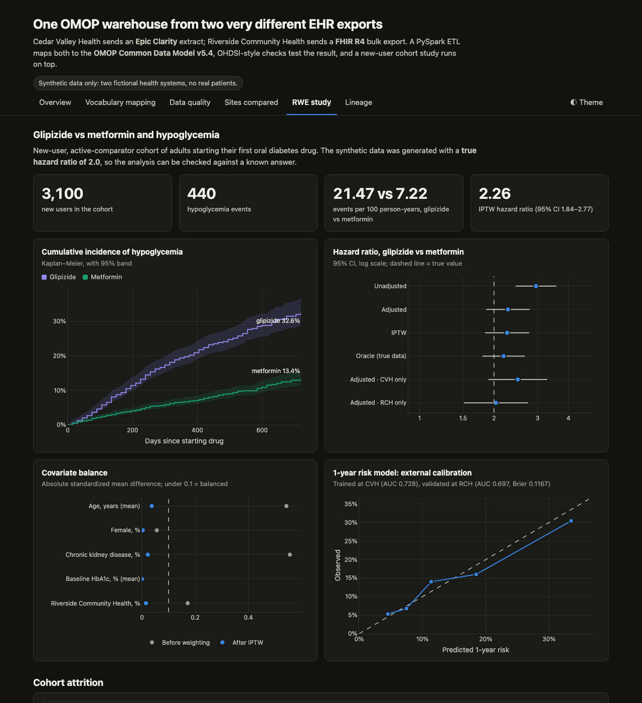
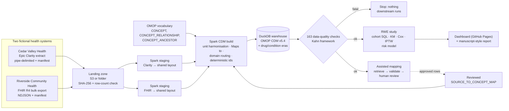
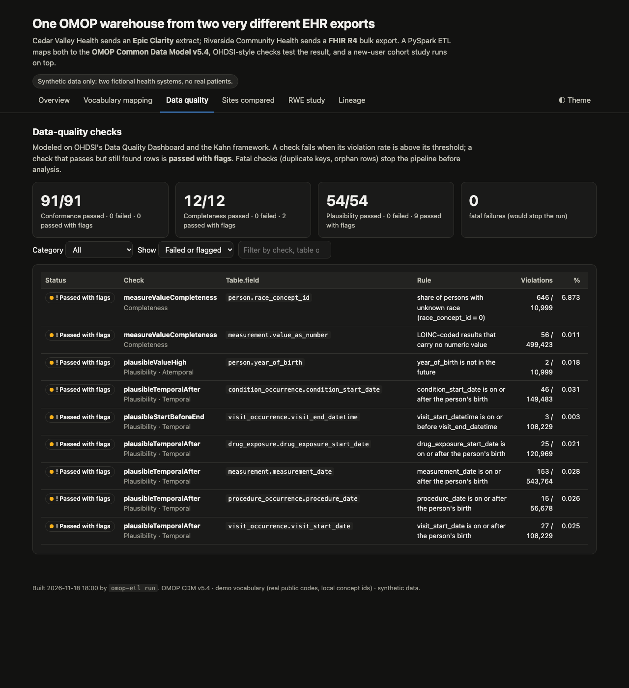
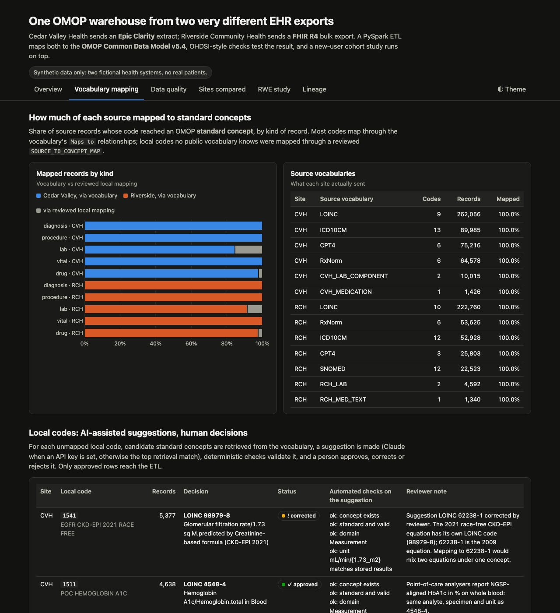

# OMOP Multi-site ETL: two EHR formats, one research-ready CDM

An end-to-end **clinical data engineering** proof of concept. Two fictional health systems send their data in two very
different formats: an **Epic Clarity** extract and a **FHIR R4** bulk export. A **PySpark** ETL maps both into one
**OMOP Common Data Model v5.4** warehouse. **OHDSI-style data-quality checks** test the result, an **assisted,
human-reviewed** workflow maps local codes, and a **real-world-evidence (RWE) study** runs on top. The whole pipeline
is orchestrated as an **Airflow** DAG, lands files in **S3** (or a local folder), and publishes a dashboard and a
manuscript-style report.

> **All data is synthetic.** "Cedar Valley Health" and "Riverside Community Health" are fictional. No real patient
> data (PHI) is used anywhere. ICD-10-CM, SNOMED CT, LOINC, RxNorm, CPT and UCUM codes are real public codes with
> paraphrased names.



---

## Contents

1. [Results at a glance](#1-results-at-a-glance)
2. [Quick start](#2-quick-start)
3. [Architecture](#3-architecture)
4. [The concepts, explained](#4-the-concepts-explained)
5. [The pipeline, step by step](#5-the-pipeline-step-by-step)
6. [Real-world data problems this project handles](#6-real-world-data-problems-this-project-handles)
7. [Data quality](#7-data-quality)
8. [Assisted concept mapping with human review](#8-assisted-concept-mapping-with-human-review)
9. [The real-world-evidence study](#9-the-real-world-evidence-study)
10. [Orchestration, cloud and CI/CD](#10-orchestration-cloud-and-cicd)
11. [Repository layout](#11-repository-layout)
12. [Using real vocabularies, S3 and Airflow](#12-using-real-vocabularies-s3-and-airflow)
13. [Testing](#13-testing)
14. [Honest limitations](#14-honest-limitations)
15. [What I would build next](#15-what-i-would-build-next)

---

## 1. Results at a glance

One command (`omop-etl run`) runs the whole pipeline in about **45 seconds** on a laptop.

| | Cedar Valley Health | Riverside Community Health |
|---|---|---|
| Source format | Epic Clarity, 23 pipe-delimited tables | FHIR R4 Bulk Data export, 7 NDJSON files |
| Patients | 6,000 | 5,000 |
| Source rows / resources | 522,815 | 394,576 |
| Clinical records staged | 503,276 | 383,571 |

| OMOP CDM output | Rows |
|---|---|
| PERSON | 10,999 (1 person with no clinical data dropped, per OMOP convention) |
| VISIT_OCCURRENCE | 108,229 |
| CONDITION_OCCURRENCE | 149,483 |
| MEASUREMENT | 543,764 |
| DRUG_EXPOSURE | 120,969 |
| PROCEDURE_OCCURRENCE | 56,678 |
| OBSERVATION | 16,200 |
| DRUG_ERA / CONDITION_ERA | 20,135 / 145,412 |

| Quality and mapping | |
|---|---|
| Source records mapped to a standard concept | **100%** of 886,847 (83 distinct source codes) |
| Records rescued by reviewed local mappings | 17,373 (6 local codes; 4 automatic suggestions corrected by the reviewer) |
| Data-quality checks | **157 / 157 applicable checks pass**; 11 pass "with flags": every defect planted in the source data was found |
| Fatal failures | 0 |

| Study: glipizide vs metformin and hypoglycemia | Hazard ratio (95% CI) |
|---|---|
| Unadjusted (confounded) | 2.96 (2.45–3.57) |
| Adjusted for age, sex, CKD, HbA1c, site | **2.28 (1.86–2.79)** |
| Inverse probability of treatment weighting | **2.26 (1.84–2.78)** |
| "Oracle": same model on the simulator's ground truth | 2.19 (1.80–2.66) |
| Planted true value | 2.0 |
| Risk model, trained at one site, validated at the other | AUC 0.73 → **0.70** externally, well calibrated |

The OMOP-based estimate matches the oracle. The cohort found 98.9% of the true new users, with **100% agreement** on
treatment group and outcome. The ETL, vocabulary mapping and cohort logic preserved the clinical signal end to end.

---

## 2. Quick start

Requirements: Python 3.12, [uv](https://docs.astral.sh/uv/), Java 17 (for Spark; on macOS `brew install openjdk@17`).

```bash
uv sync                      # install dependencies into .venv
uv run omop-etl run          # generate data -> ETL -> warehouse -> checks -> study -> dashboard
open data/site/index.html    # the dashboard; the study write-up is data/reports/study_report.md
```

Other commands:

```bash
uv run omop-etl tasks                         # the task graph and its dependencies
uv run omop-etl run --only data_quality       # re-run one step (its inputs must exist)
uv run omop-etl dq                            # failed or flagged quality checks
uv run pytest                                 # 26 tests, including a small end-to-end run
```

---

## 3. Architecture



**Technology choices.**

| Need | Choice | Why |
|---|---|---|
| Transform large clinical files | **PySpark 4** (local mode) | The same DataFrame code runs on AWS EMR, Databricks or GCP Dataproc; only the master URL and paths change |
| Query the CDM | **DuckDB** | An in-process analytical database that reads Parquet directly. The SQL is plain enough to port to Postgres, BigQuery, Redshift, Snowflake or Databricks SQL |
| Orchestrate | **Apache Airflow 3** | Retries, scheduling, parallel tasks, logs. The DAG is *generated* from the same task list the CLI runs |
| Land partner files | **Amazon S3** via boto3 (or a folder) | The usual pattern for health-system data feeds |
| Statistics | **lifelines**, **scikit-learn** | Kaplan–Meier, Cox models, propensity scores, risk-model validation |
| Suggest mappings for local codes | **scikit-learn** TF-IDF retrieval + rule checks | Only real concepts can be suggested; a person always decides |

---

## 4. The concepts, explained

This section explains each idea the project uses, in plain language, and points to where it lives in the code.

### 4.1 Why a common data model?

Every EHR stores data differently. In Epic Clarity a diagnosis sits in `PAT_ENC_DX`, linked to `CLARITY_EDG`. In
FHIR it is a `Condition` resource. Another vendor uses something else again. A study written for one hospital's
tables cannot run anywhere else.

The **OMOP Common Data Model**, maintained by the open-science community **OHDSI**, fixes this. Every site converts its
data into the *same* tables with the *same* codes. A study written once then runs unchanged at any site, which is how
networks of health systems answer research questions together without sharing patient-level data.

The core OMOP tables this project fills:

| Table | Holds | Example |
|---|---|---|
| `person` | one row per patient | sex, year of birth, race |
| `observation_period` | the span when we can see the patient's care | first to last recorded activity |
| `visit_occurrence` | encounters | outpatient, telehealth, ER, inpatient |
| `condition_occurrence` | diagnoses | type 2 diabetes |
| `drug_exposure` | prescriptions and fills | metformin 500 mg, 90-day supply |
| `measurement` | labs and vitals, with values and units | HbA1c 7.2 % |
| `procedure_occurrence` | procedures | ECG |
| `observation` | other facts | history of smoking |
| `death` | date of death | |
| `drug_era`, `condition_era` | derived continuous spans | 400 days on metformin |

### 4.2 Vocabularies, concepts and standard concepts

OMOP represents every clinical idea as a **concept**: a row in the `CONCEPT` table with a numeric `concept_id`, a
`vocabulary_id` (ICD10CM, SNOMED, LOINC, RxNorm, CPT4...), a `concept_code` (for example `E11.9`) and a
`domain_id` (Condition, Drug, Measurement...).

Several vocabularies describe the same thing, so OMOP picks one **standard** vocabulary per domain and marks those
concepts `standard_concept = 'S'`:

| Domain | Standard vocabulary | Typical source vocabularies |
|---|---|---|
| Condition | SNOMED CT | ICD-10-CM (billing codes), local problem-list codes |
| Drug | RxNorm | NDC, local formulary ids |
| Measurement | LOINC | local lab component codes |
| Procedure | CPT4, SNOMED, HCPCS | ICD-10-PCS |
| Unit | UCUM | free text ("mg/dl", "oz") |

Analyses always use standard concepts. Every clinical table also keeps the **original** code in `*_source_value` and
`*_source_concept_id`, so nothing is lost and every mapping can be audited.

### 4.3 "Maps to": how a source code becomes a standard concept

`CONCEPT_RELATIONSHIP` links concepts to each other. The relationship that matters for ETL is **`Maps to`**: from a
source concept to the standard concept(s) it means. Three behaviours follow, and this project demonstrates each
([`etl/cdm.py`](src/omop_etl/etl/cdm.py)):

1. **One-to-one.** ICD-10-CM `E11.9` maps to SNOMED `44054006` (type 2 diabetes mellitus).
2. **One-to-many.** ICD-10-CM `E11.649` ("type 2 diabetes with hypoglycemia without coma") maps to **two** standard
   concepts, diabetes *and* hypoglycemia, so one source row becomes two OMOP rows. A study counting hypoglycemia
   finds it even though the source code was a diabetes code.
3. **Domain routing.** The standard concept's *domain* decides which table a row goes to, not where it came from.
   ICD-10-CM `Z87.891` (history of nicotine dependence) arrives as a diagnosis, but its standard concept is in the
   Observation domain, so it lands in `OBSERVATION`. Lab-order CPT codes (`83036`, HbA1c test) are in the
   Measurement domain, so they land in `MEASUREMENT`.

Retired codes still work. `N18.3` (CKD stage 3) was retired from ICD-10-CM in October 2020, but old records still use
it, and its `Maps to` still resolves.

### 4.4 Concept hierarchy: `CONCEPT_ANCESTOR`

`CONCEPT_ANCESTOR` stores every ancestor–descendant pair. RxNorm's *ingredient* metformin is an ancestor of the
*clinical drug* "metformin hydrochloride 500 MG Oral Tablet" and of the extended-release tablet. A cohort that asks
for "metformin" uses the ingredient and automatically includes every product containing it. This is how OHDSI's
ATLAS defines concept sets, and how [`study/cohort.py`](src/omop_etl/study/cohort.py) defines them here.

### 4.5 `SOURCE_TO_CONCEPT_MAP`: codes no public vocabulary knows

Some codes exist only at one site: an in-house lab test, a formulary substitute with no RxNorm code, free-text
medications. OMOP's answer is the **`SOURCE_TO_CONCEPT_MAP`** table, a reviewed list mapping each local code to a
standard concept. The ETL joins it exactly like `Maps to`. Here it is produced by the review loop in
[section 8](#8-assisted-concept-mapping-with-human-review) and stored in
[`mappings/source_to_concept_map_review.csv`](mappings/source_to_concept_map_review.csv).

### 4.6 The demo vocabulary (and how real Athena vocabularies plug in)

Real OMOP vocabularies are downloaded from [OHDSI Athena](https://athena.ohdsi.org). That needs a free account, and
some vocabularies (CPT4) also need a UMLS licence; they may not be redistributed in a public repo. So the project ships
a small **demo vocabulary** ([`vocab/demo.py`](src/omop_etl/vocab/demo.py)) in the **exact Athena file format**:
the same tables and columns, tab-delimited, YYYYMMDD dates.

* Every `concept_code` is a real public code.
* The `concept_id` numbers are deliberately **not** Athena's. They start at 2,000,000,001, the range OMOP reserves for
  local concepts, so nobody mistakes them for real ids.
* **The ETL never hard-codes a concept_id.** It always looks concepts up by `(vocabulary_id, concept_code)`, and a
  test enforces this. Pointing the pipeline at a real Athena download is a configuration change
  (`OMOP_ATHENA_DIR=...`), not a code change.

### 4.7 Epic Clarity

Clarity is Epic's relational reporting database (thousands of tables), refreshed nightly from the operational
Chronicles database. Health systems often share it as table extracts. Clarity has habits an ETL must know:

* **Category lists**: columns ending in `_C` hold numbers decoded through `ZC_` tables (`SEX_C` → `ZC_SEX`).
* **Contact serial numbers**: `PAT_ENC_CSN_ID` identifies an encounter; most clinical tables hang off it.
* **Flowsheets**: vitals live in `IP_FLWSHT_MEAS` rows identified by `FLO_MEAS_ID`. Blood pressure is a single string
  like `"128/82"`, **weight is stored in ounces** and height in inches.
* **Lab results**: `ORDER_RESULTS` has both `ORD_VALUE` (text) and `ORD_NUM_VALUE`, which holds `9999999` when the
  result is not a plain number (`">14.0"`, `"HEMOLYZED"`).

The simulated extract ([`sources/clarity.py`](src/omop_etl/sources/clarity.py)) reproduces all of these.

### 4.8 FHIR R4 and Bulk Data export

FHIR (Fast Healthcare Interoperability Resources) is the HL7 standard for exchanging health data as JSON
**resources**: `Patient`, `Encounter`, `Condition`, `Observation`, `MedicationRequest`, `Procedure`... FHIR is built for
**exchange**; OMOP is built for **analysis**. A **Bulk Data `$export`** delivers one NDJSON file per resource type (one
JSON object per line), which is how health systems hand over population-level data.

FHIR habits this project handles ([`sources/fhir.py`](src/omop_etl/sources/fhir.py)):

* Codes come as `coding` arrays with a `system` URI (`http://loinc.org`, `http://snomed.info/sct`...). One resource may
  carry several codings (both ICD-10-CM and SNOMED).
* Race and ethnicity are **US Core extensions** with CDC Race & Ethnicity codes.
* Blood pressure is **one** Observation (LOINC `85354-9`) with two `component`s.
* Units are UCUM codes, sometimes pounds (`[lb_av]`) or inches (`[in_i]`).
* Exports can contain **duplicate resources**.

### 4.9 ETL with a staging layer

ETL means **Extract, Transform, Load**. This pipeline has three layers:

1. **Staging** ([`etl/staging.py`](src/omop_etl/etl/staging.py)): each source is reshaped into the *same* five staging
   tables (`stg_person`, `stg_visit`, `stg_event`, `stg_care_site`, `stg_provider`). Codes stay exactly as received.
   Adding a third health system means writing one new staging function; nothing downstream changes.
2. **CDM build** ([`etl/cdm.py`](src/omop_etl/etl/cdm.py)): one shared step harmonises units, maps codes, routes rows
   by domain and assigns ids.
3. **Warehouse** ([`warehouse.py`](src/omop_etl/warehouse.py)): loads the Parquet output and the vocabulary into
   DuckDB and derives `DRUG_ERA` and `CONDITION_ERA`.

### 4.10 Deterministic surrogate keys

OMOP ids (`person_id`, `visit_occurrence_id`...) are integers. Instead of sequence numbers, every id here is a **hash of
site + source key**, kept to 53 bits so it is exact in JavaScript too. Benefits: a re-run produces the same ids,
two sites can never collide, and child tables can compute their parent's id without a join. Primary-key checks in the
quality suite guard against collisions.

### 4.11 Observation periods and eras

* **`OBSERVATION_PERIOD`** tells analysts when a person's care was visible to the data. For EHR data the usual rule is
  first-to-last recorded activity. Studies use it for "at least 365 days of prior observation" (washout).
  People with no clinical records get no observation period and, by convention, are not loaded.
* **Eras** merge separate records into continuous spans. `DRUG_ERA` rolls drug exposures up to the **ingredient**
  and joins exposures less than 30 days apart (OHDSI's standard *persistence window*): a classic gaps-and-islands SQL
  problem, solved in [`warehouse.py`](src/omop_etl/warehouse.py).

### 4.12 Data quality: the Kahn framework

The OHDSI **Data Quality Dashboard** organises checks by the **Kahn harmonized framework** (Kahn et al., *eGEMs*, 2016):

| Category | Question | Examples here |
|---|---|---|
| **Conformance** | Does the data follow the model's rules? | unique keys, required fields, foreign keys, concept in the right domain, standard concept, expected unit |
| **Completeness** | Is the data there? | share of unmapped records, persons with no visits, lab results without a value |
| **Plausibility** | Does it make clinical sense? | HbA1c between 3 and 20 %, no events before birth or long after death, pregnancy only in females, visits that end after they start |

Each check also has a **context**: *Verification* (internal consistency) or *Validation* (agreement with outside
knowledge).

### 4.13 Real-world evidence (RWE)

RWE answers clinical questions from routinely collected data (EHRs, claims) rather than randomised trials. Without
randomisation, treated groups differ, so study **design** and **adjustment** carry the weight. The concepts used here:

* **New-user design**: start everyone at their *first* use of a drug. Comparing long-time users would only include
  people who tolerated the drug ("prevalent user bias").
* **Active comparator**: compare two treatments for the same condition (glipizide vs metformin), not treated vs
  untreated, which reduces *confounding by indication*.
* **Confounding**: a factor that drives both treatment and outcome. Here, older patients and patients with kidney
  disease get glipizide more often (metformin is avoided in poor kidney function), and they also have more
  hypoglycemia anyway. A naive comparison blames the drug for part of that.
* **Kaplan–Meier**: estimates the share of each group still event-free over time, handling people whose follow-up
  ends early (censoring).
* **Cox proportional hazards model**: estimates the **hazard ratio (HR)**, how many times higher the event rate is
  in one group at any moment, optionally adjusted for covariates.
* **Propensity score and IPTW**: model each person's probability of receiving glipizide from their baseline traits,
  then weight each person by the inverse of the probability of the treatment they actually got. The weighted groups
  look alike, as in a trial.
* **Standardised mean difference (SMD)**: the difference between groups in standard-deviation units; under 0.1 is
  conventionally "balanced".
* **External validation**: a prediction model is only trustworthy if it works on data it never saw. Here it is
  trained at one health system and tested at the other, judged by **AUC** (discrimination: does it rank higher-risk
  people higher?), **calibration** (do predicted risks match observed rates?) and the **Brier score** (overall
  accuracy of the probabilities).

---

## 5. The pipeline, step by step

Every step is a function in [`pipeline.py`](src/omop_etl/pipeline.py). The list `TASKS` is the single source of
truth for both the CLI and the Airflow DAG.

| # | Task | What happens | Code |
|---|---|---|---|
| 1 | `generate_sources` | Simulates 11,000 patients over 2022–2025 and writes each site's export with a manifest (file, row count, SHA-256). Also saves the simulator's ground truth for the study population, which the ETL never reads | [`sources/`](src/omop_etl/sources) |
| 2 | `build_vocabulary` | Writes the demo vocabulary in Athena format, or copies a real Athena download | [`vocab/demo.py`](src/omop_etl/vocab/demo.py) |
| 3 | `land_cvh`, `land_rch` | Delivers each drop to the landing zone (S3 or folder) and refuses it if any checksum or row count is wrong | [`storage.py`](src/omop_etl/storage.py) |
| 4 | `stage_cvh`, `stage_rch` | Spark reshapes each format into the shared staging layout. The two run in parallel under Airflow | [`etl/staging.py`](src/omop_etl/etl/staging.py) |
| 5 | `build_cdm` | Spark: unit harmonisation → vocabulary mapping (+ reviewed local map) → domain routing → OMOP tables as Parquet, plus a per-code coverage table | [`etl/cdm.py`](src/omop_etl/etl/cdm.py) |
| 6 | `load_warehouse` | DuckDB loads the CDM and vocabulary, builds `SOURCE_TO_CONCEPT_MAP`, `DRUG_ERA`, `CONDITION_ERA` | [`warehouse.py`](src/omop_etl/warehouse.py) |
| 7 | `data_quality` | Runs 163 checks; a fatal failure stops the pipeline | [`dq/checks.py`](src/omop_etl/dq/checks.py) |
| 8 | `suggest_mappings` | Proposes mappings for any new unmapped local code and adds them to the review file as `pending` | [`mapping_assist/suggest.py`](src/omop_etl/mapping_assist/suggest.py) |
| 9 | `run_study` | Cohort SQL, KM, Cox, IPTW, site-specific models, risk model, oracle check; writes the report | [`study/`](src/omop_etl/study) |
| 10 | `build_site` | Builds the static dashboard with the data embedded | [`site/`](src/omop_etl/site) |

Field-level lineage (which source field fills which OMOP field, and the rule) is on the dashboard's **Lineage** tab
and in [`site/build.py`](src/omop_etl/site/build.py).

---

## 6. Real-world data problems this project handles

The generators plant problems found in real EHR feeds, so the ETL and checks have something real to do.

| Problem | Where | How it is handled |
|---|---|---|
| Weight stored in **ounces**, height in **inches** | Clarity flowsheets | UCUM conversion table → kg / cm ([`crosswalks.py`](src/omop_etl/etl/crosswalks.py)) |
| Blood pressure as one string `"128/82"` | Clarity flowsheets | Split into systolic (LOINC 8480-6) and diastolic (8462-4) |
| `ORD_NUM_VALUE = 9999999` with `">14.0"` or `"HEMOLYZED"` | Clarity labs | Recover `>`/`<` as `operator_concept_id` + number; otherwise value left empty, text kept |
| Retired ICD-10-CM `N18.3` | Clarity problem list | Still maps through `Maps to` |
| Lab components without a LOINC code (POC HbA1c, eGFR CKD-EPI 2021) | Clarity | Reviewed `SOURCE_TO_CONCEPT_MAP` |
| Formulary item with no RxNorm code | Clarity | Reviewed `SOURCE_TO_CONCEPT_MAP` |
| Mixed ICD-10-CM / SNOMED codings | FHIR Condition | Preference order (SNOMED first: already standard) |
| BP as a panel with components | FHIR Observation | One measurement per component |
| Pounds and inches | FHIR Observation | UCUM conversion |
| HbA1c in **IFCC mmol/mol** | FHIR Observation | Converted to NGSP % with the IFCC–NGSP master equation (only for that LOINC code) |
| HbA1c mmol/mol numbers labelled `%` | FHIR Observation | Cannot be fixed safely: **flagged** by `plausibleValueHigh` |
| Local-only lab codes, text-only medications | FHIR | Reviewed `SOURCE_TO_CONCEPT_MAP` |
| Duplicate resources in the export | FHIR | De-duplicated by resource id |
| Encounters ending before they start | FHIR | **Flagged** by `plausibleStartBeforeEnd` |
| Birth year typed 100 years late | Clarity | **Flagged** by `plausibleValueHigh` and `plausibleTemporalAfter` |
| A patient with no clinical records | both | Not loaded (no observation period), recorded in `_etl_dropped_persons` |

---

## 7. Data quality

163 checks are generated in [`dq/checks.py`](src/omop_etl/dq/checks.py) and stored in `results.dq_check_results`. A
check counts violating rows out of the rows it applies to; it **fails** above its threshold, and a check that passes
but still found rows is shown as **passed with flags**, so nothing is hidden.

| Category | Checks (applicable) | Passed | Passed with flags | Failed |
|---|---|---|---|---|
| Conformance | 91 | 91 | 0 | 0 |
| Completeness | 12 | 12 | 2 | 0 |
| Plausibility | 54 | 54 | 9 | 0 |

The flags are exactly the planted defects: 4 mislabelled HbA1c values, 2 impossible birth years (and the 268 events
dated before those "births"), 3 encounters that end before they start, 646 persons with unknown race, and 56 LOINC
results with no numeric value (the `"HEMOLYZED"` results).

**Severity.** Duplicate keys and orphan rows are *fatal*: they mean the ETL itself is broken, so the pipeline raises
`FatalQualityError` and the study never runs on bad data. Clinical-plausibility findings are *warnings*: they are
facts about the source data that a human should review with the site.

**Two checks specific to a multi-site CDM:**

* `sourceCodeMappingCoverage` per site: share of each site's records that did not reach a standard concept.
* `crossSiteDistribution`: after harmonisation, the median HbA1c, weight, height and glucose should agree across sites.
  If one site were still sending ounces, this check would catch it.



---

## 8. Assisted concept mapping with human review

Mapping local codes by hand is slow; accepting automatic matches unchecked is unsafe, because a wrong mapping silently
corrupts every study that uses it. [`mapping_assist/suggest.py`](src/omop_etl/mapping_assist/suggest.py) splits the
work between the machine and a person:

1. **Retrieve.** For each unmapped code, find candidate standard concepts in the expected domain from the vocabulary
   itself (character n-gram TF-IDF on concept names, after expanding clinical abbreviations such as "POC" and
   "eGFR"). Only *real* concepts can be suggested, so a concept id can never be invented.
2. **Suggest.** The closest candidate becomes the suggestion, with a confidence level from its similarity score.
3. **Validate.** Deterministic checks run on every suggestion: the concept exists, is standard and valid, is in the
   expected domain, the source unit matches what is already stored for that concept, and drug strength and
   **release form** agree.
4. **Review.** Suggestions go to `mappings/source_to_concept_map_review.csv` as `pending`. Only a person changes a row
   to `approved`. The ETL loads approved rows only, and the tool never overwrites a reviewed row.

**What happened in this run.** Six local codes were found. The reviewer approved two suggestions and **corrected
four**:

| Local code | Suggested | Reviewer decision | Why |
|---|---|---|---|
| CVH `1541` "EGFR CKD-EPI 2021 RACE FREE" | LOINC 62238-1 | **98979-8** | 62238-1 is the 2009 equation; the race-free 2021 equation has its own code |
| CVH `1511` "POC HEMOGLOBIN A1C" | LOINC 4548-4 | approved | same analyte, specimen and unit |
| RCH `EGFR21` | LOINC 62238-1 | **98979-8** | as above |
| CVH `500007` "GLIPIZIDE 5 MG TAB (CVH FORMULARY SUB)" | RxNorm 310490 | approved | same product |
| RCH "Metformin ER 500mg tab" | RxNorm 6809 (ingredient) | **860975** (24 HR ER tablet) | the validator flagged the release-form mismatch |
| RCH `GLU-POC` "Glucose, point of care (fingerstick)" | LOINC 2339-0 | **41653-7** | fingerstick = capillary blood by glucometer |

Two points worth noticing. The deterministic validator caught the extended-release error on its own. And the eGFR
error passed every automatic check (right domain, right unit), so it needed **clinical knowledge**: that is why a
person stays in the loop. One more effect: once point-of-care HbA1c was mapped, every study patient had a baseline
HbA1c, which changed the study's covariate set. Mapping quality reaches all the way into the results.



---

## 9. The real-world-evidence study

**Question.** Among adults with type 2 diabetes starting their first oral glucose-lowering drug, does starting
**glipizide** (a sulfonylurea) instead of **metformin** raise the risk of **hypoglycemia**? Sulfonylureas are known to,
which makes this a good test of the pipeline: the answer should come out right.

**Design** (SQL in [`study/cohort.py`](src/omop_etl/study/cohort.py), written against OMOP tables only):

| Step | Persons |
|---|---|
| 1. First exposure to metformin or glipizide (any product, via `CONCEPT_ANCESTOR`) | 5,559 |
| 2. Did not start both on the same day | 5,559 |
| 3. At least 365 days of prior observation (new user) | 3,110 |
| 4. Type 2 diabetes diagnosis on or before index | 3,110 |
| 5. No insulin before index | 3,110 |
| 6. No hypoglycemia in the prior year | 3,102 |
| 7. Age 18 or older | **3,100** |

Outcome: first hypoglycemia diagnosis after index (SNOMED 302866003, reached from ICD-10-CM E16.2 *and* E11.649
through mapping). Follow-up: intention-to-treat, up to 730 days, censored at end of observation or death.

**Results** (models in [`study/analysis.py`](src/omop_etl/study/analysis.py)):

* 1,041 glipizide and 2,059 metformin new users; 440 events over 3,768 person-years: **21.5 vs 7.2 per 100
  person-years**.
* Before weighting, glipizide users were older (SMD 0.54) and more often had kidney disease (SMD 0.56). After IPTW,
  every SMD was below 0.04.
* HR **2.96 unadjusted → 2.28 adjusted → 2.26 IPTW**. Adjustment removed the confounding and moved the estimate to
  the planted value of 2.0. The proportional-hazards test for treatment gave p = 0.89 (assumption holds).
* By site: Cedar Valley 2.50 (1.90–3.28), Riverside 2.04 (1.51–2.74). The confidence intervals overlap, so the
  effect is consistent across health systems.
* **Oracle check.** Because the data is synthetic, the true exposure, kidney status and event date of every simulated
  patient are known. The same model fitted on that ground truth gives 2.19 (1.80–2.66). Our OMOP estimate (2.28)
  matches it. The small gap from 2.0 is sampling noise shared by both: across 8 independent larger simulations the
  simulator's mean HR was 1.97.
* **Risk model.** A logistic model for 1-year hypoglycemia, trained at Cedar Valley (AUC 0.73), validated at Riverside
  with **AUC 0.70** and close calibration across fifths of predicted risk.

The generated write-up, with methods, results, limitations and reproducibility notes, is
`data/reports/study_report.md` (also published next to the dashboard).

---

## 10. Orchestration, cloud and CI/CD

**Airflow.** [`dags/omop_pipeline.py`](dags/omop_pipeline.py) builds the DAG from `TASKS`: nightly schedule, 2 retries,
one active run, the two sites staged in parallel. It has been run end to end on **Airflow 3.4** with `dag.test()`;
all 12 tasks succeed. That run also caught a real bug: Spark's Python workers picked up a different Python than the
driver when launched by Airflow. The fix pins `PYSPARK_PYTHON` ([`etl/spark.py`](src/omop_etl/etl/spark.py)).

**S3.** Set `OMOP_LANDING_URI=s3://bucket/prefix` and each drop is uploaded to S3, pulled back, and verified against
its manifest before Spark reads it. Tests run this against a mocked S3 (moto). On EMR or Databricks, Spark would read
`s3a://` paths directly.

**CI/CD** ([`.github/workflows/ci.yml`](.github/workflows/ci.yml)):

1. `test`: ruff lint, pytest, then the full 11,000-patient pipeline, uploading the dashboard and reports.
2. `airflow`: installs Airflow 3, runs `dag.test()` on a small dataset, and checks that the dashboard was produced.
3. `pages`: on `main`, publishes the dashboard to GitHub Pages.

---

## 11. Repository layout

```
omop-multisite-etl/
├── src/omop_etl/
│   ├── sources/           clinical_model.py (simulator), clarity.py (Epic Clarity writer), fhir.py (FHIR writer)
│   ├── vocab/demo.py      demo vocabulary in Athena format
│   ├── etl/               spark.py, staging.py (source → staging), cdm.py (staging → OMOP), crosswalks.py
│   ├── warehouse.py       DuckDB load, SOURCE_TO_CONCEPT_MAP, eras
│   ├── dq/checks.py       163 OHDSI-style checks
│   ├── mapping_assist/    retrieval + validation + review file
│   ├── study/             cohort.py (SQL), analysis.py (KM, Cox, IPTW, risk model, oracle), report.py
│   ├── site/              dashboard builder + template
│   ├── storage.py         landing zone (folder or S3) + manifest verification
│   ├── pipeline.py        the task graph shared by CLI and Airflow
│   └── cli.py             `omop-etl`
├── dags/omop_pipeline.py  Airflow DAG
├── mappings/              reviewed SOURCE_TO_CONCEPT_MAP decisions
├── tests/                 26 tests
├── docs/img/              screenshots
└── .github/workflows/     CI/CD
```

`data/` is created by `omop-etl run` and is not committed.

---

## 12. Using real vocabularies, S3 and Airflow

```bash
# Real OHDSI vocabularies: download from athena.ohdsi.org (include SNOMED, ICD10CM, LOINC, RxNorm, CPT4, UCUM),
# unzip, run CPT4 reconstitution, then:
OMOP_ATHENA_DIR=/path/to/vocabulary uv run omop-etl run
```

```bash
# S3 landing zone (uses your normal AWS credentials)
uv sync --extra aws
OMOP_LANDING_URI=s3://my-bucket/partner-drops uv run omop-etl run
```

```bash
# Airflow 3
uv pip install "apache-airflow>=3.0,<4"
export AIRFLOW__CORE__DAGS_FOLDER=$PWD/dags AIRFLOW__CORE__LOAD_EXAMPLES=False
airflow db migrate && airflow dags reserialize
OMOP_SMALL=1 python dags/omop_pipeline.py      # dag.test(): every task once, in order
```

---

## 13. Testing

`uv run pytest` runs 26 tests in about 25 seconds, including a complete small pipeline run (1,100 patients through
Spark). They check, among other things:

* the vocabulary is internally consistent, and no concept id is hard-coded anywhere in the ETL
* generators are deterministic, and manifests catch a tampered file
* S3 landing works (mocked with moto)
* one-to-many mapping, domain routing, retired codes, unit conversion, the BP split, `9999999` handling
* no id collisions across sites; every person has an observation period; eras roll up to ingredients
* the quality checks find the planted defects, and a duplicate key is fatal
* the mapping validator rejects wrong-domain, invented and wrong-release-form suggestions, and the tool never
  overwrites a reviewed row
* the study's attrition never grows, estimates are finite, IPTW balances the groups, and the oracle agrees
* the task graph is a valid DAG, and the Airflow DAG has the same tasks (when Airflow is installed)

---

## 14. Honest limitations

* **Synthetic data.** The simulator is simple: no time-varying treatment, few comorbidities, clean timestamps. Real
  feeds are messier in ways it does not model (merged patient records, time zones, late-arriving data).
* **Demo vocabulary.** 88 concepts with local ids, not the millions in Athena. The code paths are vocabulary-agnostic,
  but it has not been run against a full Athena download in this repo.
* **Quality checks.** Modeled on OHDSI DQD check types; thresholds are this project's choices. In production I would
  also run the official R `DataQualityDashboard` against a Postgres copy of the CDM.
* **Reviewer.** The mapping decisions in `mappings/` were made while building this project, as an example of the
  workflow, not by a clinical terminology committee.
* **Scale.** Spark runs in local mode on 11,000 patients; the same code is written for a cluster, but it has not been
  benchmarked on one.

---

## 15. What I would build next

* Load to **Postgres** and run the official OHDSI **DataQualityDashboard** and **Achilles** for a side-by-side check.
* **Incremental loads**: process only new or changed source records, using the deterministic ids.
* **De-identification** step before data leaves a site (date shifting, ZIP truncation).
* A **FHIR → OMOP** path for more resource types (AllergyIntolerance, Immunization, DiagnosticReport).
* An **ATLAS-compatible** cohort definition (JSON) generated from the concept sets.
* **Genomic data**: OMOP's oncology and genomic extensions, linking variants to clinical outcomes.
